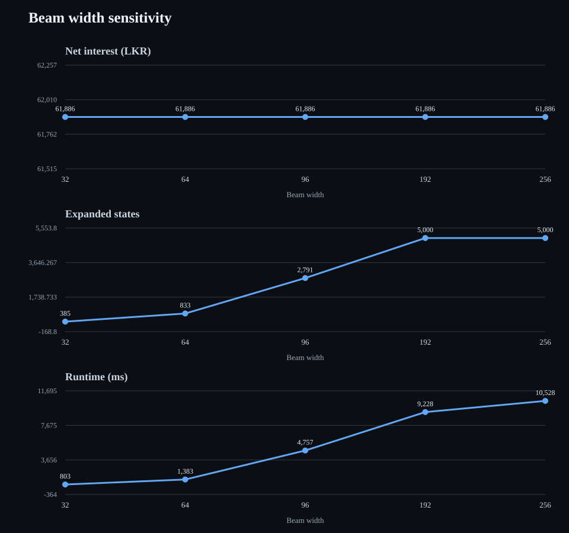
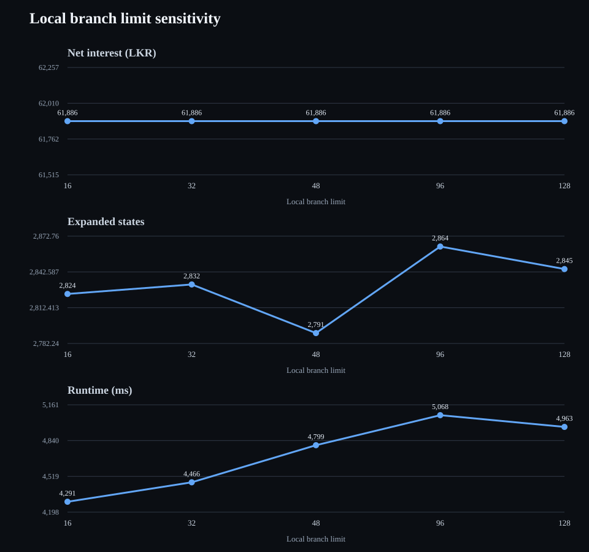
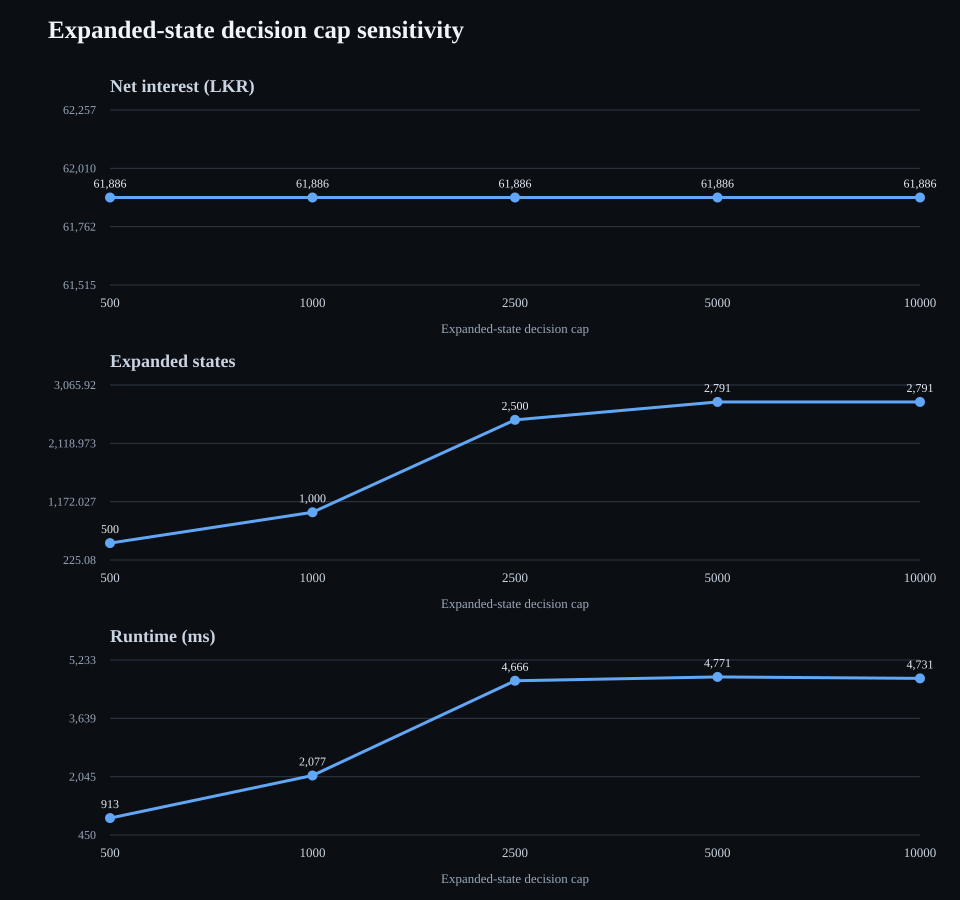

# Absolute R+ — technical reference

## Overview

Absolute R+ is the bounded, layered search strategy for the **scoped date-range objective**. It shares the search transition model with Absolute R but applies explicit limits to frontier breadth, local booking combinations and optionally expanded states.

**Implementation:** `src/strategies/absolute-plus.js` (legacy module path retained for compatibility) and `src/strategies/search-strategy-base.js`.

## Planning model

1. Build a simulation context containing accounts, eligible FD products, cash-flow schedules, transfer fees and the scoped investment horizon.
2. Run Greedy to obtain a feasible incumbent.
3. Expand each retained search state into feasible local booking, consolidation and carry decisions.
4. Advance each candidate to the next relevant event date, including FD cash flows/maturities, inflows and outflows.
5. Score states using the scoped terminal-portfolio objective and retain a bounded frontier.
6. Emit the best retained path as revision-bound session decisions. `SimulationRuntime` processes actual events and executes those decisions.

Scoped state identity, memoisation, terminal-value ranking, local ordering and root-strategy diversity remain the strategy's defining behaviour.

## Search controls

| Setting | Default | Meaning |
|---|---:|---|
| `beam_width` | 256 | Maximum candidate states retained at each search layer. |
| `max_local_branches` | 128 | Maximum partial local-booking combinations retained during one state expansion. `null` disables this local limit. |
| `max_decisions` | Unlimited | Optional cap on expanded search states. |

These controls limit different parts of the search. Increasing a limit can improve the best result found, but may increase runtime and memory. A larger setting is not guaranteed to improve the result monotonically because search ordering and pruning effects remain.

## Optimality and limitations

Absolute R+ reports `optimality_proven` only when the search completes without a decision-budget stop, beam pruning or local-combination pruning. Otherwise, the result is the best feasible path found within the configured bounds, not a proof of global optimality.

Diagnostics include expanded states, terminal leaves, bound and memo pruning, beam pruning, local-combination pruning, peak root strategy frontier, alternative leaf returns and effective settings.

## Benchmark and sensitivity

The following controlled experiment varies one Absolute R+ search limit at a time. All runs use the actual `SimulationEngine`, the repository's DFCC, Commercial Bank and NDB catalogues, and an identical scoped scenario:

- Start: 5 November 2026; horizon: 24 months.
- LKR 300,000 starting capital across three accounts at DFCC, Commercial Bank and NDB.
- No inflows or outflows; eFD eligible; AIT enabled at 10%; simple interest.
- Baseline controls: beam width 96, local branch limit 48, decision cap 5,000.

Each graph has separate panels for net interest after AIT and transfer fees, expanded search states, and measured runtime. Runtime is specific to the CI runner; it is useful for relative cost within this run, not as a hardware-independent benchmark. Full raw results: [Absolute R+ search results](./benchmarks/gaml-search-results.json).

### Beam width

### Local branch limit

### Expanded-state decision cap

### Observations

- Net interest did not change across any of the 15 parameter settings: every run returned LKR 61,886.03. In this scenario, increasing search limits did not improve the selected financial outcome.
- Increasing beam width from 32 to 256 raised runtime from about 0.80 s to 10.53 s; the 192- and 256-wide runs both reached the 5,000-state cap.
- Local branch limit had modest, non-monotonic runtime impact. Runtime ranged from about 4.29 s to 5.07 s. Expanded-state counts stayed near 2,800, while local-combination pruning fell as the branch limit increased.
- Decision caps of 500, 1,000 and 2,500 were reached; caps of 5,000 and 10,000 both stopped naturally after 2,791 expanded states and produced effectively the same runtime.
- No run proved optimality. Pruning occurred in every run, so identical net interest is evidence of a stable result for this scenario, not a global-optimality guarantee.

This is a historical one-factor sensitivity baseline, not a universal tuning prescription. Re-run it with different horizons, inflows and bank/account mixes before choosing production defaults. Measurements were produced by the [Absolute R+ sensitivity runner](../../scripts/gaml-sensitivity.js).

## Diagnostics and compatibility

The public display name is **Absolute R+**, where R denotes the scoped date range. The JSON strategy identifier remains `gaml`, and `gaml_settings`, `gaml` and the historical source module path remain supported for compatibility. The CLI accepts `absolute-r-plus` and the legacy `absolute-plus` alias.
