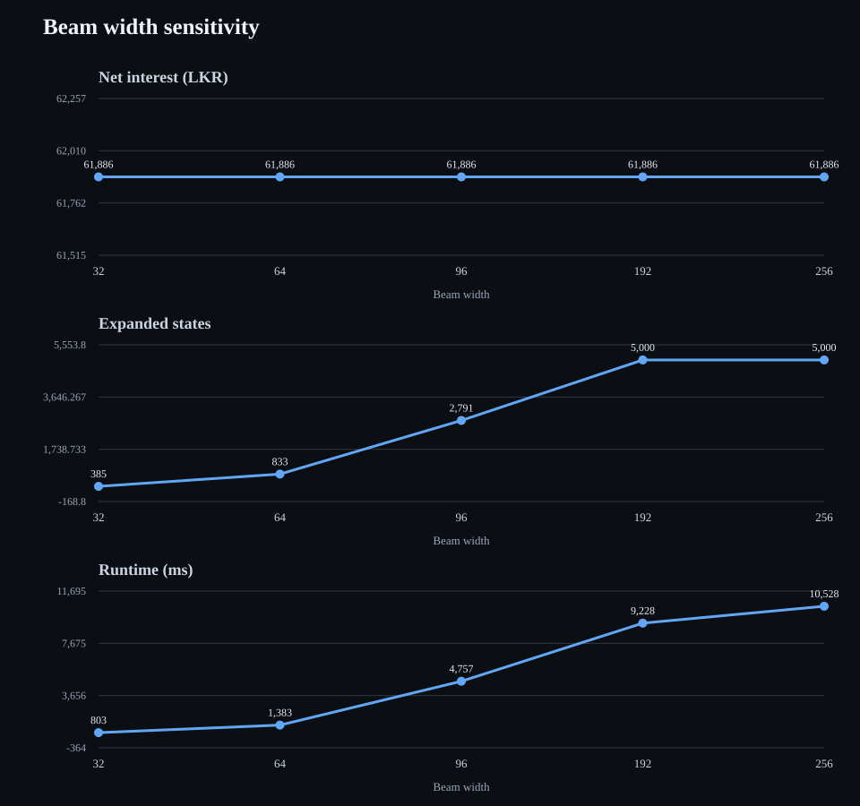
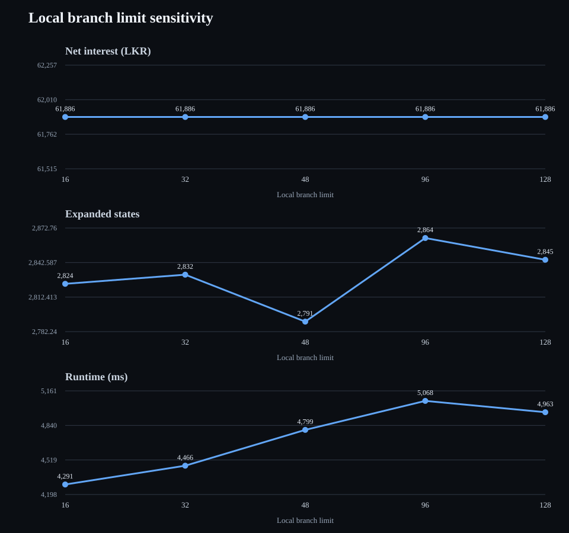
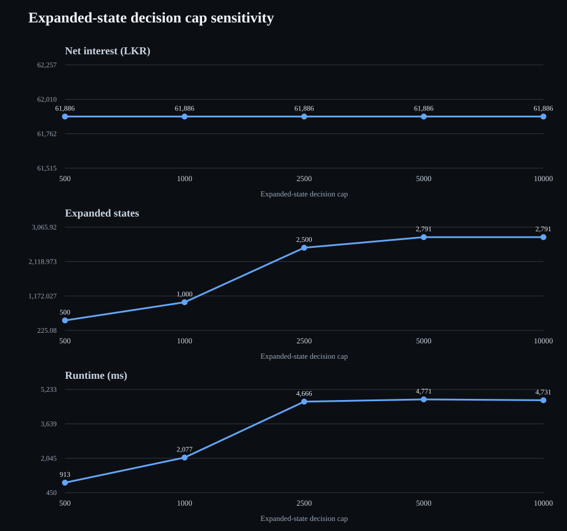

# GAML — technical reference

## Purpose

GAML is FD Cal's bounded, layered beam-search optimiser. It explores multiple candidate investment paths instead of committing to one locally selected plan. It is heuristic while any search states, local combinations or frontier candidates are pruned.

**Implementation:** `src/strategies/gaml.js` and `src/strategies/search-strategy-base.js`.

## Search model

1. Build a simulation context containing accounts, eligible FD products, cash-flow schedules, transfer fees and the investment horizon.
2. Run Greedy to obtain a feasible incumbent and lower-bound candidate.
3. Expand each retained search state into feasible local booking, consolidation and carry decisions.
4. Advance each candidate to the next relevant event date, including FD cash flows/maturities, inflows and outflows.
5. Score resulting states and retain a bounded frontier for the next layer.
6. Emit the best retained path as revision-bound session decisions. `SimulationRuntime` processes actual events and executes those decisions.

The search state includes the date, account balances, pending FD cash flows, outflow obligations and paid outflows. Memoisation and dominance pruning reduce repeated or inferior states.

## Search controls

| Setting | Default | Meaning |
|---|---:|---|
| `beam_width` | 256 | Maximum number of candidate states retained at each search layer. |
| `max_local_branches` | 128 | Maximum partial local-booking combinations retained while expanding a state. `null` disables this local limit. |
| `max_decisions` | Unlimited | Optional cap on expanded search states. Reaching it stops further search. |

These controls limit different parts of the search:

- **Beam width** controls breadth across the retained frontier.
- **Local branch limit** controls the combinations considered inside one state expansion.
- **Decision cap** controls the total number of states expanded.

Increasing one limit does not remove the other limits. Higher values can improve the best result found, but may increase runtime and memory. A larger setting is not guaranteed to improve the result monotonically because the search is heuristic and pruning/order effects remain.

## Optimality status

GAML reports `optimality_proven` only when the search completes without a decision-budget stop, beam pruning or local-combination pruning. Otherwise, the result is the best feasible path found within the configured bounds, not a proof of global optimality.

The diagnostics include expanded states, leaves, bound and memo pruning, beam pruning, local-combination pruning, peak root strategy frontier, alternative leaf returns and the effective settings. Review these alongside net interest and runtime; a higher return obtained with more work should be judged against its additional computational cost.

## Parameter sensitivity study

The following controlled experiment varies one GAML search limit at a time. All runs use the actual `SimulationEngine`, the repository's DFCC, Commercial Bank and NDB FD catalogues, and an identical financial scenario:

- Start: 5 November 2026; horizon: 24 months.
- LKR 300,000 starting capital across three accounts at DFCC, Commercial Bank and NDB.
- No inflows or outflows; eFD eligible; AIT enabled at 10%; simple interest.
- Baseline controls: beam width 96, local branch limit 48, decision cap 5,000.

Each graph has separate panels for net interest after AIT and transfer fees, expanded search states, and measured runtime. Runtime is specific to the CI runner; it is useful for relative cost within this run, not as a hardware-independent benchmark. Full raw results: [gaml-search-results.json](./benchmarks/gaml-search-results.json).

### Beam width

### Local branch limit

### Expanded-state decision cap

### Observations

- **Net interest did not change** across any of the 15 parameter settings: every run returned LKR 61,886.03. In this scenario, increasing search limits did not improve the selected financial outcome.
- **Beam width had the clearest computational cost.** Increasing it from 32 to 256 raised runtime from about 0.80 s to 10.53 s; the 192- and 256-wide runs both reached the 5,000-state cap.
- **Local branch limit had modest, non-monotonic runtime impact.** Runtime ranged from about 4.29 s to 5.07 s. Expanded-state counts stayed near 2,800, while local-combination pruning fell as the branch limit increased.
- **The decision cap controls work directly until the search naturally exhausts its frontier.** Caps of 500, 1,000 and 2,500 were reached; caps of 5,000 and 10,000 both stopped naturally after 2,791 expanded states and produced effectively the same runtime.
- **No run proved optimality.** Pruning occurred in every run, so identical net interest is evidence of a stable result for this scenario, not a global-optimality guarantee.

The experiment is deliberately a one-factor sensitivity check, not a universal tuning prescription. Re-run it with different horizons, inflows and bank/account mixes before choosing production defaults. Raw measurements were produced by the [GAML sensitivity runner](../../scripts/gaml-sensitivity.js).

## Interpretation and use

Use GAML when exploring alternative future booking sequences is worth more computation than a fast local heuristic. Start with defaults, then increase one control at a time. Compare identical financial inputs and record:

- Net interest after AIT and transfer fees.
- Whether optimality was proven.
- Expanded states and each pruning count.
- Runtime and peak memory where available.

Do not interpret beam width or branch count as a percentage of optimality. They are search limits, not confidence scores.

## Shared simulation lifecycle

GAML exposes `createSession(context)`. Search branches remain hypothetical and produce a selected decision path; they do not process the authoritative event timeline or construct the actual result. `SimulationRuntime` executes the selected path and processes actual events. `SimulationEngine` adds the start marker and performs the single final consolidation sweep after the session completes. Search branches do not independently finalise the simulation.
