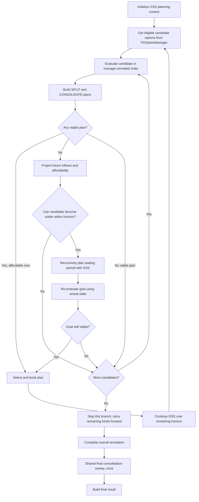

# Goal-Seeking Strategy (GSS)

## Purpose

Goal-Seeking Strategy (GSS) builds an investment plan by identifying an FD goal, determining when that goal can be achieved, and planning the intervening period without compromising the goal's liquidity requirements.

GSS is an independent strategy. It does not invoke Greedy or delegate any part of its planning to Greedy.

## Responsibilities

GSS is responsible for:

- Evaluating candidate FD goals against the current simulation state.
- Building and comparing SPLIT and CONSOLIDATE plans.
- Determining whether a goal is affordable now or can become affordable at a future date.
- Planning waiting periods recursively using GSS itself.
- Preserving the liquidity required by parent goals while allowing suitable interim investments.
- Rechecking planned goals against actual simulation events and balances.
- Continuing the planning process after a goal is booked.

FDOptionManager is responsible for FD-option discovery, eligibility, and option ordering. GSS consumes the candidate options supplied by that manager; it does not independently rank FD options by interest rate or tenor. GSS evaluates whether each candidate can form a viable plan in the current simulation context.

## Planning flow

### 1. Initialize the planning context

GSS receives the simulation inputs:

- Investment start and end dates.
- Initial capital and account balances.
- Accounts and their bank identities.
- FD options through FDOptionManager.
- Scheduled inflows and outflows.
- Transfer-fee configuration.
- Compounding and tax settings.

The planning context must retain the overall simulation horizon. A recursive planning boundary must not be mistaken for the end of the overall investment horizon when determining whether an FD can mature in time.

### 2. Discover candidate goals

At the current consideration date, GSS requests the full set of relevant eligible FD options from FDOptionManager.

The manager owns option eligibility and ordering. This includes the option-level rules and ordering already defined by FDOptionManager. GSS must not add a second, competing rate/tenor ranking policy.

GSS considers the returned candidates in the manager-provided order and evaluates each candidate in the context of available accounts, balances, dates, and parent liquidity constraints.

### 3. Generate and compare plans

For each candidate goal, GSS evaluates both plan types:

- **SPLIT:** Allocate funds across eligible accounts and FD options without requiring all funds to be moved into one account.
- **CONSOLIDATE:** Transfer funds where necessary, account for the applicable transfer fees, and aggregate the required amount in a suitable target account.

Each plan is checked against the relevant constraints, including:

- Available and projected funds.
- FD minimum and maximum investment amounts.
- Account and bank eligibility.
- Option availability on the intended booking date.
- Transfer fees and resulting net return.
- Maturity within the overall investment horizon.
- Liquidity needed to satisfy any parent goal.

GSS compares the viable SPLIT and CONSOLIDATE plans for the candidate. If a candidate cannot produce a viable plan, GSS rejects it and proceeds to the next candidate. It must not stop merely because the first candidate is not viable.

### 4. Determine whether the goal is achievable now or later

If a viable plan is affordable at the current consideration date, GSS can select it for booking.

If it is not affordable, GSS projects scheduled future inflows to determine whether, and when, the required amount may become available. Future inflows can be earmarked toward the goal, but they do not necessarily have to remain idle until then.

Before accepting a future target date, GSS must verify that:

- The required funds are expected to be available by that date.
- The candidate FD is available on that date.
- The FD can mature within the overall simulation horizon.
- The plan's transfers, fees, account constraints, and parent liquidity requirements remain valid.

If a candidate cannot become viable within the horizon, GSS rejects it and tries the next candidate.

### 5. Recursively plan the waiting period

When a goal is achievable only at a future date, GSS invokes GSS recursively to plan the period between the current date and the target date.

The recursive invocation receives the relevant simulation state and future events. It can discover and pursue its own goals during that waiting period.

Interim investments are permitted only when the resulting maturity proceeds and other available liquidity preserve the funds required by the parent goal on its target date. The parent goal therefore acts as a liquidity constraint on the recursive plan; it does not require all earmarked funds to remain idle.

A recursive invocation can itself identify a later goal and recursively plan its own waiting period. This produces a hierarchy of goals and a chronological sequence of investment decisions.

### 6. Re-evaluate using actual events

Scheduled future inflows provide the initial basis for projecting affordability. As the simulation advances, actual events can change the available balances and the earliest feasible target date.

Relevant events include:

- Scheduled inflows and outflows.
- FD interest payments.
- FD maturities and returned principal.
- Transfers and transfer fees.

GSS must re-evaluate a planned goal against the actual state before booking it. If interim interest or maturities make the goal affordable earlier, GSS may refine the target date and re-plan the affected waiting period.

Any refinement mechanism must be bounded and must converge; it must not create uncontrolled recursive replanning.

### 7. Book the goal and continue

At the target date, GSS rechecks:

- Actual available balances.
- Candidate FD availability and eligibility.
- Minimum and maximum amounts.
- Transfer and consolidation feasibility.
- Parent and remaining-horizon constraints.

If the goal is still viable, GSS executes the selected plan, records the bookings and transfers, and schedules the resulting interest and maturity events.

GSS then continues planning over the remaining overall investment horizon. If the target has become nonviable, it rejects that candidate and tries the next candidate rather than booking an invalid plan.

### 8. Candidate exhaustion and recursion threshold

If all candidates for a recursive planning period have been evaluated and none can produce a viable goal, that branch stops. Remaining funds stay liquid and carry forward to the enclosing or subsequent planning context.

There is no Greedy fallback and no other strategy is substituted.

The configurable `small_period_days` threshold limits further subdivision of waiting periods. Reaching the threshold stops additional waiting-period recursion; it does not invoke another strategy or disable evaluation of goals that are already achievable in that period.

## Simulation finalization

Finalization belongs to the shared simulation lifecycle, not to GSS or Greedy.

After the selected strategy has completed planning and the overall simulation horizon has been processed, the shared lifecycle performs the final consolidation sweep exactly once, then calculates final balances and builds the simulation result.

Recursive planning boundaries are not simulation finalization boundaries. They must not trigger intermediate final sweeps.

## High-level flow

## Core invariants

1. **Strategy independence:** GSS never calls Greedy.
2. **Single source of option ordering:** FDOptionManager owns FD-option eligibility and ordering; GSS does not duplicate its rate/tenor ranking.
3. **Complete candidate consideration:** GSS evaluates the candidate list rather than committing blindly to its first entry.
4. **Plan comparison:** Both SPLIT and CONSOLIDATE are considered for each candidate.
5. **Recursive self-planning:** Waiting periods are planned by GSS recursively.
6. **Parent-goal liquidity:** Interim investments must preserve the liquidity required by parent goals.
7. **Actual-state validation:** A future goal is revalidated against actual balances and events before booking.
8. **No strategy fallback:** Candidate exhaustion stops the branch and carries remaining funds forward.
9. **One simulation finalization:** The shared lifecycle performs the final consolidation sweep once, after the overall horizon.
