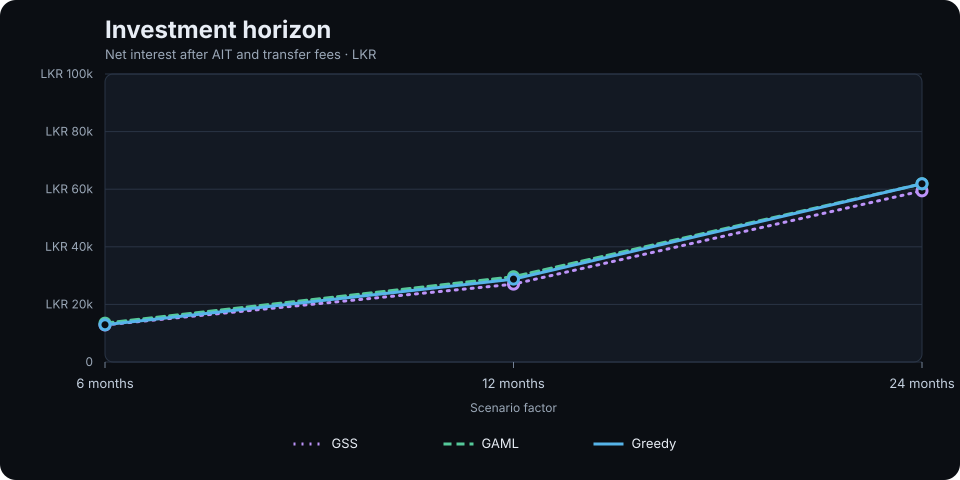
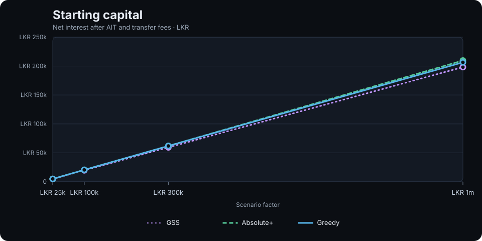
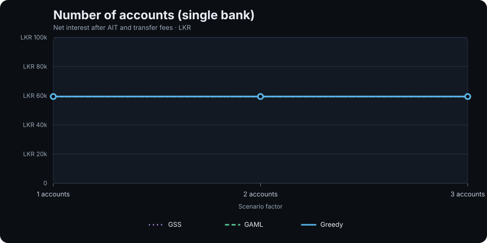
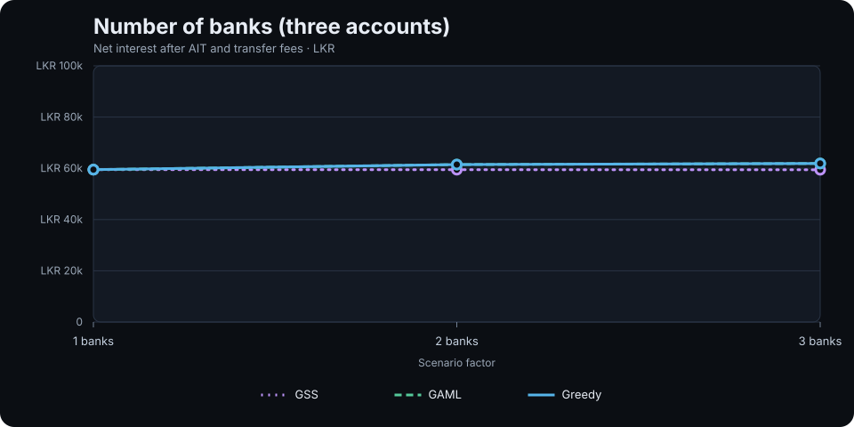
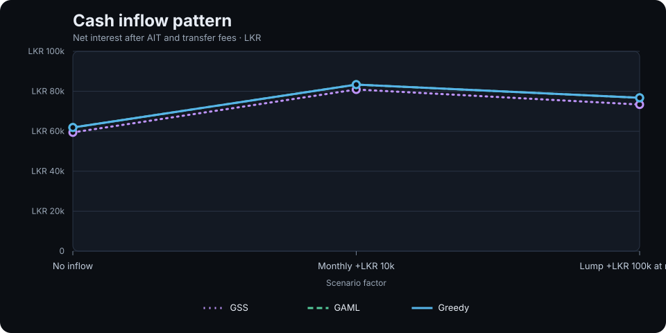
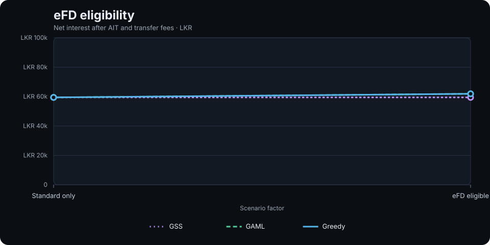
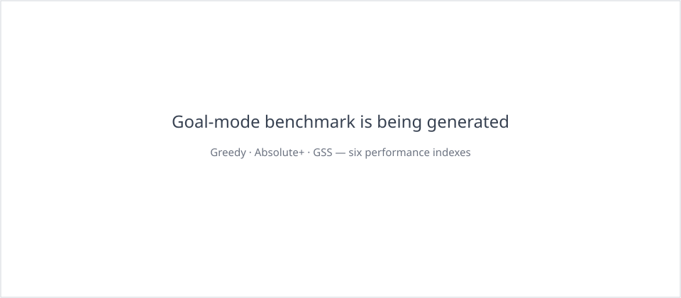

> **Scope note:** The scoped sensitivity study below is the active strategy comparison. The Goal-mode dashboards and measurements retained later in this document are historical development artifacts only; Goal mode is currently disabled in the public UI, CLI configuration and schema. They do not represent supported strategy choices or a current ranking.

# Strategy sensitivity benchmark

This study executes the repository's actual `SimulationEngine` and the three strategies available in the web application: **Greedy**, **Absolute R+** and **GSS**. Each comparison changes one scenario factor at a time and gives every strategy the same inputs.

All plotted values are **net interest after AIT and transfer fees**, in LKR. They are not gross interest or final portfolio value. This is the fixed-horizon study; goal-based runs use a separate objective and matrix documented in [Goal Achievement Sensitivity](./goal-achievement.md).

## Benchmark setup

| Parameter | Setting |
|---|---|
| Start date | 5 November 2026 |
| Horizons | 6, 12 and 24 months |
| Starting capital sweep | LKR 25,000; 100,000; 300,000; 1,000,000 |
| Account sweep | 1, 2 and 3 accounts, all at DFCC |
| Bank sweep | 1, 2 and 3 banks across a fixed 3-account portfolio |
| Inflow sweep | None; LKR 10,000 monthly; LKR 100,000 once after 6 months |
| eFD eligibility | Standard-only vs eFD-eligible accounts |
| AIT | Enabled at 10% |
| Interest calculation | Simple interest; actual leap-year day basis |
| Outflows | None |
| Transfer fees | Bank-specific catalogue fees; applied to transfers and final sweep |

The general base portfolio is LKR 300,000 across three accounts and three banks over 24 months. Horizon, capital, inflow and eFD sweeps use that base. For the account-count sweep, all accounts use DFCC so the bank catalogue stays constant. For the bank-count sweep, account count and total capital remain fixed while the selected bank set expands. Scheduled inflows are deposited into the first (DFCC) account.

## Bank product catalogues

The benchmark used the product rows already stored in the repository. All three catalogues are marked `populated_direct`.

| Bank | Product rows | Rate-data note |
|---|---:|---|
| DFCC Bank PLC | 70 | Bank-published schedule effective 1 October 2026 |
| Commercial Bank of Ceylon PLC | 48 | Bank-published rate page; effective date not displayed in the source |
| National Development Bank PLC | 35 | Bank-published schedule last updated 24 August 2026 |

Sources: [DFCC rates](https://www.dfcc.lk/personal-banking/dfcc-leasing/rates-and-tariff?tab=fixed_deposits), [Commercial Bank rates](https://www.combank.lk/rates-tariff), [NDB deposit rates](https://www.ndbbank.com/rates/interest-rates-on-deposits).

Transfer fees follow the bank catalogue: DFCC LKR 30 inter-bank, Commercial Bank LKR 25, and NDB LKR 25; intra-bank transfers are configured at LKR 0. The DFCC fee source includes a note that its published amount conflicts with the CBSL digital CEFTS maximum, so verify the current channel tariff before treating the modelled fee as a live quote. Sources: [DFCC local payments](https://www.dfcc.lk/personal/local-payments), [Commercial Bank tariff](https://www.combank.lk/rates-tariff), [NDB general tariff](https://ndbbankweb.ndbbank.com/images/download/pdf/General_Tariff_-_English.pdf).

## Sensitivity graphs

Each chart overlays all three strategy results for the same factor. Numeric inputs use a linear numeric horizontal axis, so point spacing reflects the actual difference between tested values; categorical sweeps retain equal category spacing. Exact machine-readable rows are available in [benchmark-results.json](./benchmarks/results.json).

### Investment horizon

The horizontal axis is linear in months (6, 12 and 24). The 12-month point is placed one-third of the way from 6 to 24 months, reflecting the actual numeric interval.

### Starting capital

The horizontal axis is linear in LKR (25k, 100k, 300k and 1m). Unequal capital intervals therefore occupy unequal horizontal distances. This avoids visually presenting the four test points as equally sized increases. The vertical axis remains linear in net interest.

### Number of accounts

The three strategy lines overlap because the measured returns are effectively identical across one, two and three accounts in this single-bank scenario. The near-flat result is meaningful: splitting the same capital across more accounts did not improve the available rate or net return in this catalogue snapshot.

### Number of banks

The Greedy and Absolute R+ lines overlap in this comparison. GSS remains close to its one-bank result and does not capture the same benefit from adding banks.

### Cash inflows

### eFD eligibility

## Findings

### 1. Longer horizons increase absolute net interest

With LKR 300,000 across three banks, Greedy returned LKR 12,933.28 at 6 months, LKR 28,778.95 at 12 months and LKR 61,886.03 at 24 months. Absolute R+ was ahead by 4.28% and 2.90% at 6 and 12 months, then matched Greedy at 24 months. GSS was 0.56% behind at 6 months and 3.98–6.09% behind at the longer horizons.

### 2. More accounts alone did not improve return

Holding the bank fixed at DFCC and total capital at LKR 300,000, 1, 2 and 3 accounts all produced approximately LKR 59,481.37 net interest. The booking count increased with account count, but the return did not. Account fragmentation by itself did not create a rate advantage in this product set.

### 3. Bank diversity improved the Greedy result in this catalogue

With three accounts and LKR 300,000 total capital, the Greedy result rose from LKR 59,481.38 with DFCC only to LKR 61,460.41 with DFCC and Commercial Bank, then LKR 61,886.03 with all three banks. That is a 4.04% increase from one to three banks, after modelled transfer fees of LKR 0, 25 and 50 respectively. Absolute R+ matched Greedy at all three points. GSS did not capture the same gain in the multi-bank cases.

### 4. Inflows raise total interest, but later capital has less time to earn

At 24 months, no inflow produced LKR 61,886.03 net interest on LKR 300,000 principal. Monthly LKR 10,000 inflows raised net interest to LKR 83,353.99 on LKR 540,000 total principal. A single LKR 100,000 inflow after six months produced LKR 76,752.44 on LKR 400,000 principal.

The absolute interest rises as more capital enters, but the net-interest-to-total-principal ratio falls: approximately 20.63% with no inflow, 15.44% with monthly inflows and 19.19% with the later lump sum. This is a timing effect, not a strategy loss: later deposits simply have fewer days to earn interest.

### 5. eFD eligibility was worth LKR 2,454.65 in the tested baseline

For Greedy and Absolute R+, enabling eFD eligibility increased net interest from LKR 59,431.38 to LKR 61,886.03 (+4.13%). GSS remained around LKR 59,421.46 when eFDs were enabled, slightly below its standard-only result. This is a strategy-specific gap worth investigating; eligibility expanded the available products but GSS did not convert that expansion into a better outcome in this scenario.

### 6. Absolute R+'s search cost rises sharply with recurring inflows

Absolute R+ matched Greedy on the monthly-inflow case, but used the full 5,000 expanded-state budget and took about 95 seconds in this CI run. Greedy completed in milliseconds and GSS in under 20 ms. Runtime is environment-dependent, but the relative cost is material. Absolute R+'s result is bounded and does not prove optimality; the study records `optimality_proven: false`.

## Strategy interpretation

- **Greedy** was the strongest or tied strongest result in most tested scenarios, with very low runtime. It remains a useful baseline.
- **Absolute R+** found improvements in some short-horizon and capital cases, but often returned the Greedy result despite materially higher search cost. Its bounded result is not an optimality proof.
- **GSS** remained very fast, but underperformed Greedy on several multi-bank, longer-horizon and inflow scenarios. The eFD result also suggests that broader candidate availability is not automatically being converted into better goal outcomes.

These are observations from this fixed catalogue snapshot and the stated one-factor sweeps, not universal rankings. Rate schedules, product minima, payout types, fees and eligibility all influence the result.

## Absolute R+ search-parameter sensitivity

A separate controlled experiment varies Absolute R+'s beam width, local branch limit and expanded-state decision cap independently. Each sweep holds the other two settings and the financial scenario constant. Results and overlay charts are published alongside the main study once the run completes and is reviewed.

## Scoped-mode compatibility check for dual-scope strategy work

The dual-scope implementation was compared against the archived fixed-horizon baseline before changing the benchmark assumptions:

- The current run on 5 November 2026 at 21:54 UTC produced the same **all non-timing fields** as the archived run at 09:00 UTC across all 54 Greedy, Absolute R+ and GSS scenario rows. There were zero differences in financial results, fees, booking counts, or other recorded result fields.
- The 15-point Absolute R+ search-parameter sweep also matched the archived baseline in every non-timing field: net interest, expanded states, beam pruning, local-combination pruning and optimality status were unchanged.
- Median measured runtimes were 3 ms vs 3 ms for Greedy, 2 ms vs 1 ms for GSS, and 3.40 s vs 5.87 s for Absolute R+ across the 18 scenario points per strategy. The Absolute R+ parameter-sweep median was 3.62 s vs 4.73 s. These are runner-specific samples; they are not used as proof of a speedup. The important compatibility evidence is that the financial outputs and search diagnostics are unchanged.
- Absolute is not part of the web-strategy sensitivity matrix and has no archived pre-change performance matrix. Its scoped compatibility is covered by the legacy search-parity tests; a dedicated pre-change Absolute timing baseline is unavailable.

This is a strong scoped-regression check for the web strategies: goal-specific provenance, ranking and waiting logic do not alter the scoped financial outcomes or Absolute R+ search diagnostics.

## Goal-scope strategy benchmarks

The historical Goal-mode matrix used a different objective from this fixed-horizon study: minimise elapsed time to the first valid consolidation net-interest credit. Goal mode is now disabled pending the Absolute R-only rework. The dedicated goal-mode matrix compares Greedy, Absolute R+ and GSS over 21 one-factor scenario inputs (63 strategy runs). Its six dashboards report elapsed days, credited interest, computation time, transfer fees, credited interest per day and target attainment.

See the [goal-based simulation methodology and interpretation](./goal-achievement.md) for the scenario definitions, accounting contract, limitations and raw data.

### Goal target

### Starting capital

### Account count

### Bank count

### Inflow pattern

### eFD eligibility

Raw measurements: [goal-mode benchmark results](./assets/goal-achievement/results.json). These assets are regenerated together by the goal-achievement sensitivity workflow; computation times are single-run CI measurements, and bounded Absolute R+ results are not global optimality proofs.

## Reproducibility and limitations

- Run `node scripts/strategy-sensitivity.js` from the repository root to repeat the study.
- The workflow archives the raw output as a GitHub Actions artifact.
- Absolute R+ uses a 96-state beam, 48 local branches and a 5,000 expanded-state budget. Its results are approximate.
- Absolute is CLI-only and exhaustive; it is not included in this web-strategy comparison.
- No outflows, early-termination penalties, liquidity preference, or rate changes during the forecast are modelled.
- Published bank rates are a dated data snapshot, not guaranteed live offers. Confirm minimum balances, account eligibility, payout conditions and current tariffs with each bank before investing.
