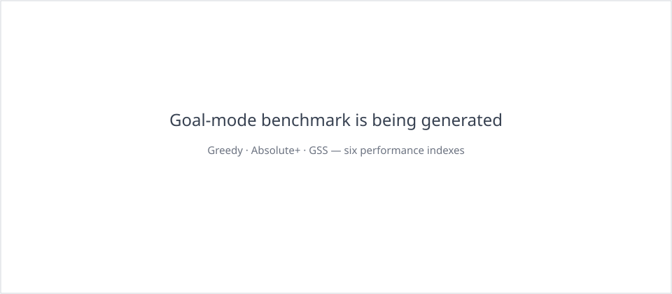
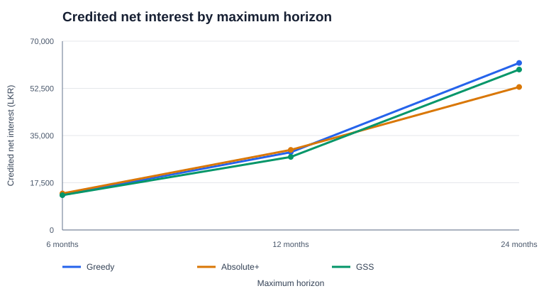

# Goal-Based Simulation

Goal-based simulation is a third horizon mode alongside time-based and scoped simulation. It terminates at the first event boundary where the configured amount of **net interest first credited to the consolidation account** reaches the target, or at the internal safety horizon if the target is not reached.

## Objective and accounting

The metric is cumulative, first-credit-only net interest received by the configured consolidation account. It is not portfolio value, gross interest, or unrealised interest earned by FDs in other accounts.

- Opening balances and external inflows are principal.
- FD cash flows separate returned principal from interest after AIT.
- Interest paid to a non-consolidation account is not counted until it is transferred to consolidation.
- Transfer provenance follows principal, uncredited interest, and previously counted interest.
- Mixed transfers and their fees are allocated proportionally across the components.
- AIT reduces interest before it can be recognised.
- Outflows consume balance provenance proportionally. Previously credited interest remains part of the historical goal metric after later withdrawals or transfers.
- Reinvesting or moving counted interest cannot count it again.

The runtime reconciles provenance to cash balances. Unattributed balance changes in non-goal runs are conservatively classified as principal and reported in `provenance_adjustments`. Goal runs reject provenance mismatches rather than silently treating unknown money as interest.

## Simulation modes

The shared configuration contract uses `simulation.mode`:

| Mode | Required horizon inputs | Stop condition |
|---|---|---|
| `scoped` | `investment.start_date`, `investment.end_date` | Explicit end date |
| `goal` | `investment.start_date`, goal target | First goal crossing; a 30-year internal safety horizon protects against non-terminating runs |

Goal configuration:

```json
{
  "simulation": {
    "mode": "goal",
    "goal": {
      "metric": "consolidation_net_interest",
      "target": 50000
    }
  },
  "investment": {
    "start_date": "2026-11-05"
  }
}
```

Goal outcomes are explicit:

- `achieved`: includes target, actual credited interest, achievement date, elapsed days, and overshoot.
- `goal_not_reached`: includes actual credited interest, internal safety horizon, and remaining shortfall.
- Invalid simulations remain invalid; they are not converted into ordinary unachieved outcomes.

Legacy configurations without a `simulation` object continue to normalize as scoped simulations.

## Runtime and strategy behaviour

The shared `SimulationRuntime` owns cash-flow execution, AIT, transfers, provenance, outflows, and goal threshold detection. `SimulationEngine` owns strategy-session progression and exactly-once finalization. Strategies do not implement independent goal termination.

- **Greedy** retains its existing decision policy and uses the shared goal stop.
- **GSS** retains its existing planner initially; its goal-mode behaviour is measured before policy redesign.
- **Absolute+** replays terminal candidates through the authoritative runtime and compares goal outcomes lexicographically: achievement before non-achievement, earliest achievement, higher credited interest on the same date, lower transfer fees, fewer operations, then deterministic terminal-value/signature tie-breakers. Its beam and decision budgets remain bounded. Candidate paths that fail authoritative runtime replay are rejected and counted with failure reasons rather than aborting the search. Candidate comparison is only as complete as the explored search frontier; bounded runs do not prove global optimality.
- **Absolute** uses the exhaustive search path and the same goal-aware terminal comparison, without beam pruning.

When a goal is achieved before the maximum horizon, later events are not processed and the final consolidation sweep is skipped so it cannot alter the recorded achievement amount. When the maximum horizon is reached without achievement, the final consolidation sweep is processed with provenance; interest first credited by that sweep is recognised at the maximum-date boundary.

## Reports

Goal reports lead with the target, credited amount, status, achievement date, elapsed days, and overshoot or shortfall. The event timeline includes cumulative credited net interest at each processed boundary. Existing fixed-horizon report sections remain available.

## Sensitivity study

Run the reproducible one-factor-at-a-time matrix with:

```sh
node scripts/goal-achievement-sensitivity.js
```

The study compares Greedy, Absolute+, and GSS with the same financial inputs per test point. It varies:

- Goal target: LKR 10k, 25k, 50k, 75k, 100k.
- Starting capital: LKR 25k, 100k, 300k, 1m.
- Account count: 1, 2, 3.
- Bank count: 1, 2, 3.
- Inflows: none, monthly LKR 10k, quarterly LKR 30k, lump LKR 100k.
- eFD eligibility: standard-only or eligible.
- Maximum scope: 6, 12, 24 months.

The bank suite is DFCC, Commercial Bank, and NDB. AIT is enabled, compounding is disabled, and the same catalogue and transfer-fee configuration are used across strategies. The Absolute+ benchmark uses a recorded bounded budget (beam width 96, local branches 48, 5,000 expanded decisions). The output records achievement date/days, credited interest at stop, shortfall, fees, bookings, runtime, search expansions, and proof status.

Outflows are excluded from the primary sensitivity matrix even though the shared runtime has policy and provenance regression coverage; performance conclusions with outflows require a separate study. The benchmark output is uploaded as a GitHub Actions artifact by the strategy sensitivity workflow. Results must be interpreted as measurements under the stated budget, not as proof that Absolute+ globally optimises every case.

## Measured benchmark results

<text color="secondary" size="xs">Corrected run: 5 November 2026 · 72 strategy runs · 24 one-factor test points · AIT enabled · simple interest · no outflows</text>

The base case is LKR 300,000 across three accounts and three banks, with eFD eligibility enabled and a 12-month maximum horizon.

| Goal target | Greedy | Absolute+ | GSS |
|---:|---:|---:|---:|
| LKR 10,000 | 365 days · LKR 28,824 | **151 days · LKR 10,473** | 300 days · LKR 23,297 |
| LKR 25,000 | 365 days · LKR 28,824 | **320 days · LKR 25,787** | 330 days · LKR 25,151 |
| LKR 50,000 | Not reached · LKR 28,824 | Not reached · LKR 29,692 | Not reached · LKR 27,077 |
| LKR 75,000 | Not reached · LKR 28,824 | Not reached · LKR 29,692 | Not reached · LKR 27,077 |
| LKR 100,000 | Not reached · LKR 28,824 | Not reached · LKR 29,692 | Not reached · LKR 27,077 |

*For achieved cases, the value is net interest credited at the first achievement boundary. For unachieved cases, it is credited net interest at the maximum boundary.*






Key observations:

- Absolute+ reached LKR 10,000 in 151 days and LKR 25,000 in 320 days, earlier than GSS (300 and 330 days respectively) and Greedy (365 days for both).
- LKR 50,000 and higher were not reached within 12 months from the LKR 300,000 base case. At LKR 50,000, Absolute+ ended with LKR 29,692.30 credited and a LKR 20,307.70 shortfall; Greedy credited LKR 28,824.45 and GSS LKR 27,076.51.
- With LKR 1,000,000 starting capital and a LKR 50,000 target, Absolute+ achieved in 242 days, GSS in 300 days, and Greedy at the 365-day boundary.
- Extending the base case to 24 months allowed Absolute+ to reach LKR 50,000 in 727 days, four days before Greedy and GSS at 731 days. At achievement, Absolute+ had credited LKR 53,010.45, compared with LKR 61,927.33 for Greedy and LKR 59,471.46 for GSS.

Absolute+ used a beam width of 96, local branch limit of 48, and a 5,000-decision cap. For the base LKR 50,000 target case it evaluated 1,113 search states and 172 goal candidates, with no invalid candidate replays. Other points included invalid hypothetical paths (27 at LKR 25,000 starting capital, 4 at LKR 1,000,000 capital, and 2 in the 24-month horizon case); these were rejected and counted with their reasons rather than aborting the search. The `optimality_proven` flag was false because the bounded beam pruned candidates. The reported achievement dates are the earliest candidates found within the explored frontier, not global-optimality proofs.

The full 72-row machine-readable output, including per-run fees, booking counts, runtime, search expansions, candidate counts, invalid-path reasons, and proof status, is attached to the [corrected Goal Achievement Sensitivity workflow run](https://github.com/aaron-fredrick/FD-Calculator/actions/runs/42097850306) as the `goal-achievement-sensitivity-results` artifact. The artifact is retained for 30 days.

These results are a measured baseline, not a universal ranking. Absolute+ improved time-to-goal in this tested target and capital range, while Greedy/GSS sometimes produced a higher credited amount at achievement. Outflows were excluded from this sensitivity matrix. The shared runtime has regression coverage for strict, defer, and best-effort policies, multi-account isolation, same-day credited-interest withdrawals, and provenance consumption; a separate outflow sensitivity matrix is still required before drawing performance conclusions for cash-outflow scenarios.

## Implementation plan and acceptance

See [Goal-Based Simulation Implementation Plan](goal-achievement-implementation-plan.md) for the migration sequence, accounting contract, test matrix, and acceptance gates.
